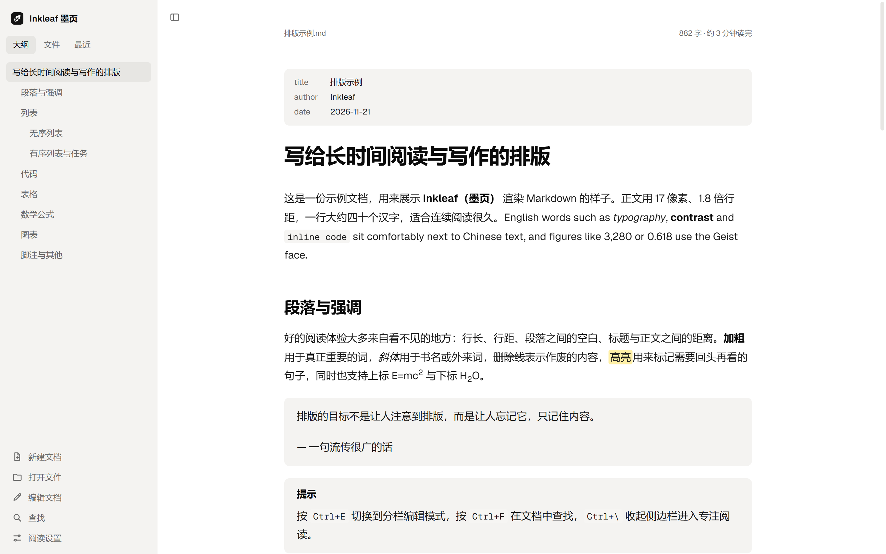
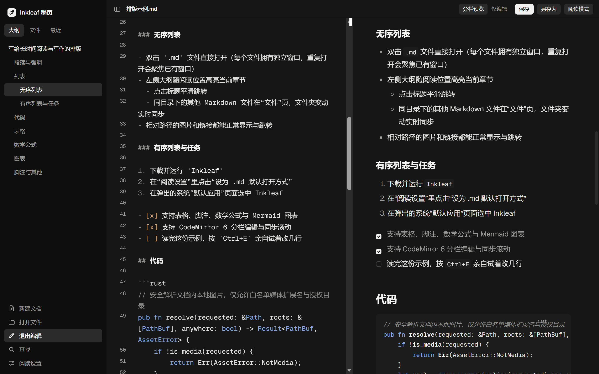

<p align="center">
  
</p>

<h1 align="center">Inkleaf (墨页)</h1>

<p align="center">
  <strong>A calm, self-contained, and security-hardened local Markdown reader and editor for Windows.</strong><br>
  Built with <strong>Tauri v2 (Rust)</strong> and the native <strong>WebView2</strong> runtime.
</p>

<p align="center">
  <a href="README.zh-CN.md">简体中文</a> ·
  <a href="#screenshots">Screenshots</a> ·
  <a href="#installation-windows">Installation</a> ·
  <a href="#shortcuts">Shortcuts</a> ·
  <a href="#development--build">Build from Source</a>
</p>

<p align="center">
  
  
  
</p>

---

## Why Inkleaf

Many Markdown tools feel either heavy to launch or cluttered like a web browser. **Inkleaf** is designed to feel like turning a quiet printed page while giving you fast editing and strict local security when you need it:

- **Calm, Distraction-Free Reading**: Achromatic chrome, stone sidebar, and a clean reading sheet where only interactive links carry color (`#1d5fbf`), keeping full focus on the text.
- **Native Speed & Tiny Footprint**: Powered by Rust and the system WebView2 engine—fast cold startup without bundling an entire Chromium runtime per app.
- **Seamless Read & Split-Edit Workflow**: Read comfortably by default, press `Ctrl+E` to open the CodeMirror 6 editor in split preview or editor-only mode, and save atomically (`Ctrl+S`) while preserving original encodings and line endings.
- **Live External Sync**: Clean documents reload automatically when updated on disk by external editors or AI coding agents, while dirty edits show a non-blocking conflict banner.
- **Local-First & Zero Telemetry**: Zero network tracking. Every opened Markdown file is treated as untrusted input behind layered sanitization and OS-level boundaries.

---

## Screenshots

### Light Reading Mode



### Dark Mode & Split Editor



---

## Features

### Calm Reading Typography
- **Thoughtful Measure & Pairing**: `Geist` + `Geist Mono` paired with Microsoft YaHei, 17px/1.8 default body measure, narrow/standard/wide page width presets, and smooth font scaling.
- **Live Outline & Folder Sync**: Auto-generated `H1`–`H6` outline tracking active reading position, real-time sibling Markdown file list updates, CJK/word count, and reading time estimation.
- **Clean Printing & PDF Export**: Pressing `Ctrl+P` in dark mode automatically switches the rendered page and Mermaid diagrams to light theme colors before opening the print dialog.
- **Image Lightbox & Find in Document**: Click any rendered image to inspect in a smooth lightbox; `Ctrl+F` highlights and jumps through matches cleanly.

### Responsive Source & Split Editing (`Ctrl+E`)
- **CodeMirror 6 Integration**: Toggle between **Split** preview and **Editor only** layout. Split mode syncs scroll position by heading anchors and scroll ratio; editor-only mode supports full `Ctrl+F` source search and jump highlights.
- **Encoding & EOL Preservation**: Automatically detects UTF-8 (with/without BOM), UTF-16 LE/BE, and legacy encodings (such as GBK via `chardetng` + `encoding_rs`), saving atomically via same-directory temporary files while preserving original encoding and CRLF / LF line endings.

### Rich Technical Markdown
- **Extended Syntax**: GFM tables with alignment, task lists, footnotes, `==highlight==`, `^superscript^`, `~subscript~`, GitHub-style callouts (`> [!NOTE]` / `TIP` / `IMPORTANT` / `WARNING` / `CAUTION`), and YAML front matter cards.
- **Code, Math & Diagrams**: Syntax-highlighted code blocks (`highlight.js`) with one-click copy, inline/display KaTeX math (`$...$`, `$$...$$`, ```` ```math ````), and lazy-loaded theme-aware Mermaid diagrams.

### Multi-Window & Bilingual UI
- **Single-Instance Multi-Window**: Open or drag multiple documents into dedicated windows; opening an already-open document via shell double-click, `Ctrl+O`, folder list, or recent files automatically focuses its existing window.
- **Bilingual UI (zh-CN / en)**: Automatically detects system language and supports live switching between Auto, 中文, and English.

---

## Installation (Windows)

Inkleaf ships ready-to-run release packages—**no manual runtime setup required**:

### Installer (Recommended — Auto Dependency Setup)

1. Download `Inkleaf_<version>_x64-setup.exe` (or `arm64-setup.exe`) from [Releases](../../releases) or the local `release/` folder.
2. Run the executable and **simply choose your installation folder** (per-user NSIS install, no administrator privileges required).
3. **Automatic Runtime Setup**:
   - The installer embeds Microsoft's WebView2 Evergreen Bootstrapper and automatically detects and installs the WebView2 Runtime silently if missing.
   - For completely offline environments, place `MicrosoftEdgeWebView2RuntimeInstallerX64.exe` (directly or under `runtime\`) next to the setup executable and it will be detected and installed silently.
4. **Co-Located Environment & Config**:
   - Post-install creates a `data\` runtime directory and `settings.json` directly inside your chosen installation directory (if a preset `settings.json` sits next to the setup executable, it is copied automatically).
   - Registers `.md`, `.markdown`, `.mdown`, `.mkd`, `.mkdn`, and `.mdx` file associations and cleanly removes them along with co-located data on uninstall.

### Portable Package

1. Extract `Inkleaf_<version>_x64-portable.zip` to any writable directory (contains `inkleaf.exe`, a default `settings.json`, and `THIRD_PARTY_LICENSES.md`).
2. Launch `inkleaf.exe` directly. Both `settings.json` and `data\WebView2\` live alongside the executable without cluttering `AppData`.
   > Note: If the executable is placed in a read-only directory (such as a protected system path), Inkleaf safely falls back to `%APPDATA%\Inkleaf\settings.json` and `%LOCALAPPDATA%\Inkleaf`.

> Verification: Verify release file hashes against `SHA256SUMS.txt` on the release page.

---

## Security Model

Inkleaf treats every opened Markdown document as untrusted input:

- **Scoped Local Media (`inkleaf-asset://`)**: Only allow-listed media extensions inside the active document's folder tree (up to two ancestor folders by default, unless *Local images: Anywhere* is explicitly enabled) are served after path canonicalization, with `X-Content-Type-Options: nosniff` and restrictive response CSP headers.
- **Safe Link Handling**: External links are restricted to `http:`, `https:`, and `mailto:`; `file://`, `javascript:`, and `vbscript:` links are blocked; non-document local files are **never executed**—they display a native confirmation prompt with the full path and reveal the item in File Explorer.
- **DOMPurify & Sandboxed Rendering**: Forbids `<style>`, raw `<svg>`, and `data-*` attributes in document HTML; prefixes document `id`/`name` attributes with `doc-`; caches shell DOM refs and ignores `[data-act]` inside the document container; isolates KaTeX slots; runs Mermaid with `securityLevel: 'strict'`, size/edge limits, blocked `themeCSS` directives, and secondary SVG/CSS sanitization.
- **Strict CSP & Remote Privacy**: Disables inline scripts, locks navigation to `index.html`, and blocks remote `http`/`https` images by default until opted in per document or globally.

---

## Shortcuts

| Action | Shortcut |
| --- | --- |
| Open file | `Ctrl+O` |
| New document | `Ctrl+N` |
| Toggle reading / edit mode | `Ctrl+E` |
| Save / Save As | `Ctrl+S` / `Ctrl+Shift+S` |
| Find in document / source | `Ctrl+F` (`Enter` / `Shift+Enter` / `F3`) |
| Toggle sidebar | `Ctrl+\` |
| Adjust / reset font size | `Ctrl++` / `Ctrl+-` / `Ctrl+Wheel` / `Ctrl+0` |
| Toggle dark / light theme | `Ctrl+Shift+L` |
| Print or export PDF | `Ctrl+P` |

---

## Development & Build

### Prerequisites

- **Windows 10 / 11** (x64 or ARM64) with Microsoft Edge WebView2 Runtime
- **Node.js** `>= 22.12.0`
- **Rust** `>= 1.80` (MSVC toolchain, e.g. `stable-x86_64-pc-windows-msvc`) + Visual Studio Build Tools (C++ linker)

### Development & Tests

```powershell
# Install npm dependencies
npm ci

# Run desktop app with live web reload
npm run dev

# Refresh licenses, bundle web assets, and run JS + Rust unit tests
npm run licenses
npm run build:web
npm test
cargo test --manifest-path src-tauri/Cargo.toml
```

### One-Command Release Packaging

Build all assets, run every test suite, compile the Tauri binary + NSIS installer, and output ready-to-distribute files (`*-setup.exe`, `*-portable.zip`, `SHA256SUMS.txt`) into `release/`:

```powershell
npm run release
```

### Repository Layout

```text
├── assets/                 # Source SVG and 1024px application icon
├── docs/screenshots/       # Product screenshots for documentation
├── scripts/                # Third-party license generator & release packager
├── src-tauri/              # Rust / Tauri v2 desktop host
│   ├── nsis/hooks.nsh      # NSIS install/uninstall hooks (co-located config & offline runtime)
│   ├── src/                # Host modules (docs / assets / settings / i18n / lib)
│   └── tauri.conf.json     # Window, CSP, and bundler configuration
└── web/                    # Frontend reader, CodeMirror 6 editor & unit tests
    ├── src/                # App shell, styles, Markdown pipeline, sanitizer & editor
    └── test/               # Node test-runner unit tests
```

---

## Roadmap

- [ ] Single-pane WYSIWYG editing mode (Typora-style inline block rendering)
- [ ] macOS and Linux desktop targets
- [ ] Signed releases & winget / Scoop package manifests

---

## License

Licensed under the [MIT License](LICENSE) (`© 2026 Inkleaf contributors`).  
See [THIRD_PARTY_LICENSES.md](THIRD_PARTY_LICENSES.md) for full notices of all bundled npm packages, fonts, and Rust crates.
