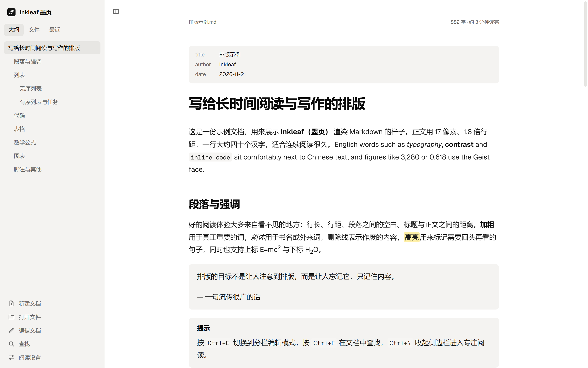
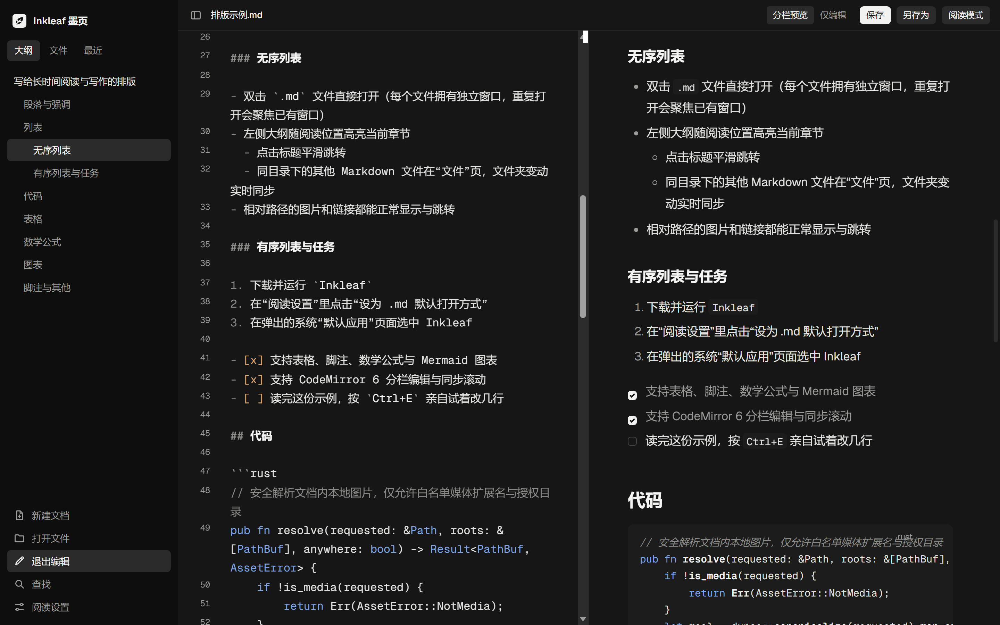

<p align="center">
  
</p>

<h1 align="center">Inkleaf（墨页）</h1>

<p align="center">
  <strong>一款像翻开纸页一样安静、开箱即用且经过安全加固的本地 Markdown 阅读与编辑器。</strong><br>
  基于 <strong>Tauri v2（Rust）</strong> 与系统原生 <strong>WebView2 / WKWebView</strong> 构建，原生支持 <strong>Windows</strong> 与 <strong>macOS</strong>。
</p>

<p align="center">
  <a href="README.md">English</a> ·
  <a href="#产品预览">界面预览</a> ·
  <a href="#安装与下载">安装与下载</a> ·
  <a href="#快捷键">快捷键</a> ·
  <a href="#开发者指南">从源码构建</a>
</p>

<p align="center">
  
  
  
</p>

---

## 为什么选择 Inkleaf

很多 Markdown 工具要么过于臃肿，启动动辄数秒；要么把“本地打开一篇文档”做成浏览器标签页般杂乱。**Inkleaf（墨页）** 坚持克制的设计哲学：

- **像纸页一样安静**：无色应用外框、石色侧边栏与纯粹阅读纸张，仅用一种蓝色标识可点击链接，让注意力完全回到文字本身。
- **原生轻量，毫秒级响应**：依托 Rust 与系统原生 WebView2，告别庞大的跨平台浏览器运行时开销，双击 `.md` 文件即刻呈现。
- **读与写无缝切换**：日常沉浸阅读；按下 `Ctrl+E` 即刻展开 CodeMirror 6 分栏源码编辑器，支持章节同步滚动、仅编辑视图切换以及多种字符编码无损保存。
- **与外部工具实时协同**：当你使用 VS Code、Cursor 或 AI 工具在后台改写本地 `.md` 文档时，Inkleaf 会自动热刷新并保持当前阅读位置；若当前窗口有未保存编辑，会在顶部给出非阻塞冲突提示。
- **纯本地、零遥测、默认安全**：不连接任何云端遥测服务，将每一份打开的 Markdown 都视作潜在不可信输入进行隔离保护。

---

## 产品预览

### 浅色沉浸阅读模式



### 深色分栏编辑模式（实时预览 + 语法高亮）



---

## 核心功能

### 沉浸式阅读排版
- **精密阅读比例**：`Geist` / `Geist Mono` 与微软雅黑混排，默认 17px 字号与 1.8 倍行高，支持窄 / 标准 / 宽三档正文宽度与无极字号调节。
- **智能导航与统计**：自动提取 `H1`–`H6` 章节大纲并随滚动实时高亮；同目录 Markdown 文件列表随增删自动同步；实时统计中英混排字数与预计阅读时长。
- **打印与 PDF 导出友好**：按 `Ctrl+P` 打印或导出 PDF 时，即使当前处于深色模式，也会自动切换为白底深字与浅色 Mermaid 图表，保证纸面输出清晰美观。
- **图片灯箱与全文查找**：点击正文图片可放大查看；`Ctrl+F` 支持高精度高亮与命中跳转。

### 顺手好用的源码编辑（`Ctrl+E`）
- **CodeMirror 6 双模式**：支持**分栏预览**与**仅编辑**两种布局；分栏模式下根据标题锚点与阅读比例智能同步滚动；仅编辑模式下同样支持 `Ctrl+F` 源码查找与定位。
- **编码与换行符原样保留**：通过 `chardetng` + `encoding_rs` 自动识别 UTF-8（含 BOM）、UTF-16 LE/BE 及 GBK 等历史编码，保存时采用同目录临时文件原子写入（`write_atomic`），保留原始编码与 CRLF / LF 换行符。

### 丰富的技术文档语法
- **Markdown 扩展**：GFM 表格（含列对齐）、任务列表、脚注、`==高亮==`、`^上标^`、`~下标~`、GitHub 风格提示块（`> [!NOTE]` / `TIP` / `IMPORTANT` / `WARNING` / `CAUTION`）及 YAML Front Matter 卡片化展示。
- **代码、公式与图表**：基于 `highlight.js` 的代码块语法高亮与一键复制；基于 `KaTeX` 的行内/块级数学公式（`$...$`、`$$...$$`、```` ```math ````）；惰性加载并随主题切换的 `Mermaid` 图表。

### 多窗口协调与双语界面
- **单实例多窗口**：每个文档拥有独立窗口，支持拖入多文件批量打开；无论是双击文件、还是在应用内通过 `Ctrl+O` / 侧边栏 / 最近列表打开已经在另一窗口开启的文档，都会直接聚焦既有窗口，杜绝多窗覆盖冲突。
- **中英双语界面**：默认跟随系统语言，支持在左下角“阅读设置”中实时切换 自动 / 中文 / English。

---

## 安装与下载

Inkleaf 提供开箱即用的发布包，**用户无需手动安装任何第三方运行时环境**：

### macOS 一键安装（Apple Silicon & Intel 通用包）

1. 前往 [Releases](../../releases) 页面（或本地 `release/` 目录）下载通用安装包 `Inkleaf_<version>_macos_universal.dmg`（单包同时原生支持 M 系列 Apple Silicon 与 Intel 处理器，要求 macOS 11.0+）。
2. 双击打开 `.dmg` 镜像，支持以下任一方式完成安装：
   - **一键自动安装（推荐）**：双击镜像中的 **`一键安装 Inkleaf (Install).command`**，脚本会自动将 `Inkleaf.app` 安装至 `/Applications`（若无管理员权限则自动回退到 `~/Applications`），自动清理 macOS 下载隔离属性（免除“无法验证开发者”弹窗拦截）、刷新 `.md` 文件关联并自动启动应用。
   - **传统拖拽安装**：将 `Inkleaf.app` 直接拖入镜像右侧的 `Applications` 文件夹即可（首次打开若遇系统未公证提示，可在右键点击应用后选“打开”，或执行 `xattr -cr /Applications/Inkleaf.app`）。

### Windows 一键安装与绿色便携版

#### 方式一：一键安装包（推荐）

1. 前往 [Releases](../../releases) 页面（或本地构建后的 `release/` 目录）下载 `Inkleaf_<version>_x64-setup.exe`（ARM64 设备请下载对应 `arm64-setup.exe`）。
2. 双击运行安装程序，**只需选择你希望的安装目录**即可（采用当前用户模式安装，无需管理员权限）。
3. **自动安装依赖环境**：
   - 安装程序内嵌 Microsoft Edge WebView2 Bootstrapper，会自动检测本机运行环境，缺失时自动静默完成安装。
   - 如需在完全断网环境安装，只需将微软官方离线安装包 `MicrosoftEdgeWebView2RuntimeInstallerX64.exe`（或放到 `runtime\` 子目录）放置在 `setup.exe` 同级目录下，安装器会自动识别并静默安装。
4. **环境配置同目录化**：
   - 安装器会自动在所选安装目录下创建运行环境目录 `data/` 与配置文件 `settings.json`（若安装程序同级目录放有预置的 `settings.json`，会自动复制带入）。
   - 安装过程自动注册 `.md`、`.markdown`、`.mdown`、`.mkd`、`.mkdn`、`.mdx` 文件关联，卸载时支持干净清除程序、环境目录及注册表关联。

#### 方式二：免安装绿色便携包（Portable）

1. 下载并解压 `Inkleaf_<version>_x64-portable.zip` 到任意可写目录，压缩包内已包含 `inkleaf.exe`、默认 `settings.json` 与开源许可声明 `THIRD_PARTY_LICENSES.md`。
2. 直接双击 `inkleaf.exe` 运行，软件配置 `settings.json` 与 `data\WebView2\` 运行缓存均保存在程序同级目录下，不污染 C 盘系统目录。
   > 注：仅当程序被放置于无写权限的只读系统目录（例如普通权限运行位于 `Program Files` 下的目录）时，软件才会自动安全回退至 `%APPDATA%\Inkleaf\settings.json` 与 `%LOCALAPPDATA%\Inkleaf`。

> 安全提示：建议下载后对比发布页提供的 `SHA256SUMS.txt` 校验文件完整性。

---

## 安全模型

Inkleaf 坚持**默认不信任任何打开的 Markdown 文件**，关键防护措施如下：

- **受控本地媒体协议（`inkleaf-asset://`）**：仅允许访问白名单媒体扩展名，且经路径规范化后默认仅限当前文档目录及向上两级祖先目录（防止 `../` 越权读取系统敏感文件；“任意路径图片”需由用户在设置中手动开启），响应头强制附加 `X-Content-Type-Options: nosniff` 与隔离 `Content-Security-Policy`。
- **链接与附件隔离**：外部链接仅放行 `http:`、`https:`、`mailto:`；严禁 `file://`、`javascript:`、`vbscript:`；其他非文档本地链接**绝不直接执行**，仅在原生弹窗展示完整路径并由文件资源管理器 / 访达定位选中。
- **DOMPurify + 插槽与严格沙箱**：禁用文档中的 `<style>`、原始 `<svg>` 与 `data-*` 属性；文档内 `id`/`name` 强制添加 `doc-` 前缀防 DOM Clobbering；外壳 `[data-act]` 委托完全屏蔽文档容器并提前缓存所有外壳 DOM 引用；KaTeX 输出经隔离插槽注入并独立净化；Mermaid 锁定 `securityLevel: 'strict'`、禁用危险指令并对输出 SVG 进行二次 CSS/节点清洗。
- **隐私默认保护**：内置严格 CSP 禁用内联脚本，锁定窗口导航仅限自身页面，默认拦截所有远程 `http`/`https` 图片加载（支持按篇或全局放行）。

---

## 快捷键

| 操作 | Windows | macOS |
| --- | --- | --- |
| 打开文件 | `Ctrl+O` | `⌘O` |
| 新建文档 | `Ctrl+N` | `⌘N` |
| 切换阅读 / 编辑模式 | `Ctrl+E` | `⌘E` |
| 保存 / 另存为 | `Ctrl+S` / `Ctrl+Shift+S` | `⌘S` / `⌘⇧S` |
| 文档内 / 源码查找 | `Ctrl+F`（`Enter` / `Shift+Enter` / `F3`） | `⌘F`（`Enter` / `⇧Enter` / `F3`） |
| 显示 / 隐藏侧边栏 | `Ctrl+\` | `⌘\` |
| 放大 / 缩小 / 重置字号 | `Ctrl++` / `Ctrl+-` / `Ctrl+滚轮` / `Ctrl+0` | `⌘+` / `⌘-` / `⌘+滚轮` / `⌘0` |
| 切换浅色 / 深色主题 | `Ctrl+Shift+L` | `⌘⇧L` |
| 打印或导出 PDF | `Ctrl+P` | `⌘P` |

---

## 开发者指南

### 环境要求

- **操作系统**：Windows 10 / 11（x64 / ARM64，需 WebView2 Runtime）或 macOS 11+（Xcode Command Line Tools）
- **Node.js**：`>= 22.12.0`
- **Rust**：`>= 1.80`（Windows MSVC 工具链或 macOS `aarch64-apple-darwin` / `x86_64-apple-darwin`）

### 本地开发与测试

```powershell
# 安装前端依赖
npm ci

# 启动带热重载的桌面开发模式
npm run dev

# 生成许可清单、打包前端并运行全套前端与 Rust 单元测试
npm run licenses
npm run build:web
npm test
cargo test --manifest-path src-tauri/Cargo.toml
```

### 一键构建发布包

执行以下命令将自动完成许可证刷新、全量测试、Tauri 编译与打包：

```powershell
# Windows：生成 setup.exe、portable.zip 与 SHA256SUMS.txt 至 release/
npm run release

# macOS（需在 macOS 环境执行）：生成通用架构 .dmg 一键安装包
npx tauri build --target universal-apple-darwin --bundles app
bash scripts/package-macos-dmg.sh
```

### 目录结构

```text
├── assets/                   # 应用矢量图标与 1024px 原图
├── docs/screenshots/         # README 展示截图
├── scripts/                  # 第三方许可生成、Windows Release 与 macOS DMG 打包脚本
├── src-tauri/                # Rust / Tauri v2 桌面端宿主源码
│   ├── nsis/hooks.nsh        # Windows NSIS 安装/卸载钩子（同目录配置与离线依赖）
│   ├── src/                  # 核心模块（docs / assets / settings / i18n / lib）
│   └── tauri.conf.json       # Tauri 窗口、CSP 与多平台打包配置
└── web/                      # 前端阅读器与 CodeMirror 6 编辑器源码及单测
    ├── src/                  # 页面结构、样式、Markdown 管线、净化器与编辑器封装
    └── test/                 # Node 内置测试框架单元测试
```

---

## 路线图

- [x] macOS 通用架构（Apple Silicon & Intel）原生支持
- [ ] Typora 风格单栏所见即所得（WYSIWYG）编辑模式
- [ ] Linux 桌面平台适配
- [ ] 代码签名、macOS 公证与 winget / Homebrew 分发清单

---

## 开源许可

本项目基于 [MIT License](LICENSE) 开源（`© 2026 Inkleaf contributors`）。  
软件内嵌及打包的第三方前端库、字体与 Rust crate 完整许可声明请参阅 [THIRD_PARTY_LICENSES.md](THIRD_PARTY_LICENSES.md)。
