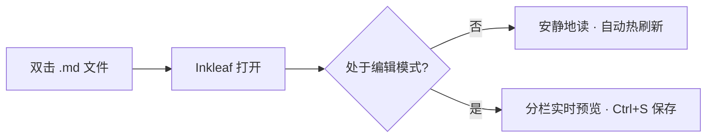

# 写给长时间阅读与写作的排版

这是一份示例文档，用来展示 **Inkleaf（墨页）** 渲染 Markdown 的样子。正文用 17 像素、1.8 倍行距，一行大约四十个汉字，适合连续阅读很久。English words such as *typography*, **contrast** and `inline code` sit comfortably next to Chinese text, and figures like 3,280 or 0.618 use the Geist face.

## 段落与强调

好的阅读体验大多来自看不见的地方：行长、行距、段落之间的空白、标题与正文之间的距离。**加粗**用于真正重要的词，*斜体*用于书名或外来词，~~删除线~~表示作废的内容，==高亮==用来标记需要回头再看的句子，同时也支持上标 E=mc^2^ 与下标 H~2~O。

> 排版的目标不是让人注意到排版，而是让人忘记它，只记住内容。
>
> — 一句流传很广的话

> [!TIP]
> 按 `Ctrl+E` 切换到分栏编辑模式，按 `Ctrl+F` 在文档中查找，`Ctrl+\` 收起侧边栏进入专注阅读。

> [!WARNING]
> 文件在别的编辑器里保存后，这里会自动刷新并保持当前阅读位置；如果你有未保存的编辑，顶部会提示你选择重新加载或保留修改。

## 列表

### 无序列表

- 双击 `.md` 文件直接打开（每个文件拥有独立窗口，重复打开会聚焦已有窗口）
- 左侧大纲随阅读位置高亮当前章节
  - 点击标题平滑跳转
  - 同目录下的其他 Markdown 文件在“文件”页，文件夹变动实时同步
- 相对路径的图片和链接都能正常显示与跳转

### 有序列表与任务

1. 下载并运行 `Inkleaf`
2. 在“阅读设置”里点击“设为 .md 默认打开方式”
3. 在弹出的系统“默认应用”页面选中 Inkleaf

- [x] 支持表格、脚注、数学公式与 Mermaid 图表
- [x] 支持 CodeMirror 6 分栏编辑与同步滚动
- [ ] 读完这份示例，按 `Ctrl+E` 亲自试着改几行

## 代码

```rust
// 安全解析文档内本地图片，仅允许白名单媒体扩展名与授权目录
pub fn resolve(requested: &Path, roots: &[PathBuf], anywhere: bool) -> Result<PathBuf, AssetError> {
    if !is_media(requested) {
        return Err(AssetError::NotMedia);
    }
    let real = dunce::canonicalize(requested).map_err(|_| AssetError::NotFound)?;
    if anywhere || roots.iter().any(|r| dunce::canonicalize(r).map(|cr| real.starts_with(cr)).unwrap_or(false)) {
        return Ok(real);
    }
    Err(AssetError::Outside)
}
```

```python
def reading_minutes(text: str) -> int:
    """中文按每分钟 400 字估算阅读时长。"""
    cjk = sum(1 for ch in text if "一" <= ch <= "\u9fff")
    return max(1, round(cjk / 400))
```

## 表格

| 元素 | 字号 | 行高 | 用途 |
| :--- | ---: | ---: | :--- |
| 正文 | 17px | 1.80 | 连续阅读 |
| 一级标题 | 34px | 1.20 | 文档标题 |
| 二级标题 | 25.5px | 1.30 | 章节 |
| 代码 | 14.6px | 1.65 | 代码块与行内代码 |

## 数学公式

行内公式 $E = mc^2$ 与正文对齐，独立公式居中显示：

$$
\int_{-\infty}^{\infty} e^{-x^2}\,dx = \sqrt{\pi}
$$

## 图表



## 脚注与其他

Markdown 由 John Gruber 在 2004 年发布[^1]，后来的 CommonMark 与 GFM 规范补上了表格和任务列表等扩展[^2]。

<details>
<summary>展开查看折叠内容</summary>

折叠块里也可以写任何 Markdown，例如 `代码` 和 **加粗**。

</details>

---

读到这里，示例就结束了。按 `Ctrl+O` 打开文件，或按 `Ctrl+N` 新建一篇笔记吧。

[^1]: 见 daringfireball.net 上的原始说明。
[^2]: GitHub Flavored Markdown，简称 GFM。
